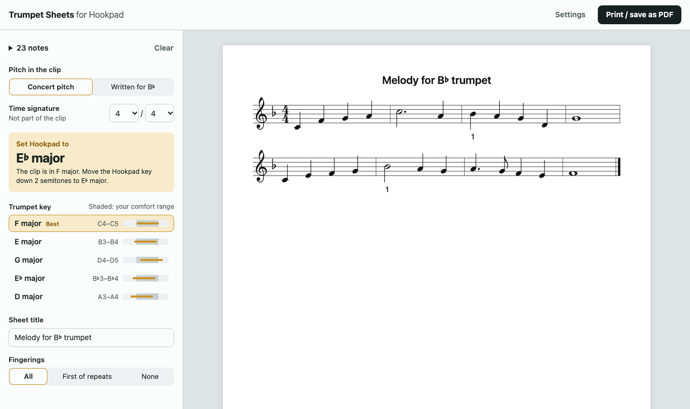

# Trumpet Sheets for Hookpad

Paste a melody copied from [Hookpad](https://www.hooktheory.com/hookpad) and get a printable sheet for B♭ trumpet, in a key and octave that suits your range, with fingerings under the notes.

**Use it: https://ramvi.github.io/trumpet-sheets-for-hookpad/**

Everything runs in your browser; nothing is uploaded. To get an app icon, use *File → Add to Dock* in Safari or *Install* in Chrome.



## How to use

1. Select the melody in Hookpad and copy it (`Cmd/Ctrl+C`).
2. Paste it into the app. Several clips pasted after each other are joined.
3. Set Hookpad to the key the app shows, so the backing matches the trumpet.
4. Print, or save as PDF.

## Good to know

- Fingerings are shown for every note except the naturals C4–C5. They can be turned off.
- Hookpad clips carry no time signature. 4/4 is assumed; pick another in the app. One signature applies to the whole sheet.
- Hookpad's octave 0 is assumed to be the octave whose tonic is nearest middle C.
- Keys are ranked by how well the melody fits your range (editable under *Settings*), then by awkward fingerings and key signature.

## Development

Requires Node.js 22.12 or newer.

```sh
npm install
npm run dev
npm test           # unit tests
npx playwright install chromium
npm run test:e2e   # browser and PDF test
```

## License

[MIT](LICENSE). Not affiliated with Hooktheory.
